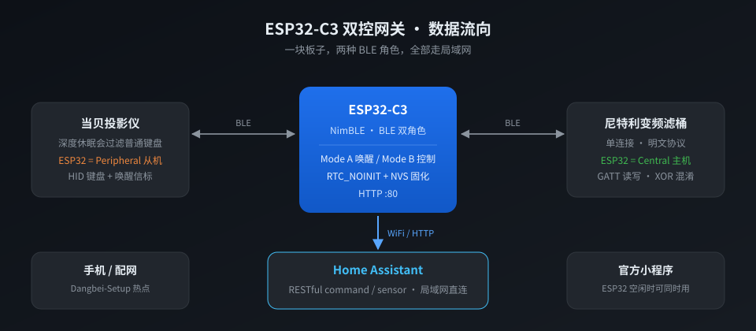

# ESP32-C3 Dual-Role BLE Gateway: Dangbei Projector + Netlea Canister Filter

[](https://github.com/lee1985-cn/dangbei-netlea-hub/releases/latest)
[](#)
[](#)
[](LICENSE)

[中文](README.md) | **English**



A **single ESP32-C3** (a ~$2 dev board, no extra circuitry) that plays **two BLE roles at the same time**:

- **BLE Peripheral** — impersonates a HID keyboard + replays the factory wake beacon to control a **Dangbei projector** (power, volume, play/pause) with zero cloud dependency.
- **BLE Central** — speaks the **reverse-engineered GATT protocol** of a **Netlea (尼特利) variable-speed canister filter** (on/off, speed 1–20, feeding pause).

Both are exposed over plain LAN HTTP for Home Assistant. No MQTT broker, no vendor cloud, no app.

> This project extends the projector-only firmware in [lee1985-cn/dangbei-projector-ha](https://github.com/lee1985-cn/dangbei-projector-ha).

---

## Why this exists (the interesting part)

Two separate hard problems, solved on one MCU:

### 1. The projector filters out ordinary BLE keyboards in deep sleep

A standard `BleKeyboard` sketch simply cannot wake a Dangbei projector — the projector's BLE stack drops non-whitelisted devices while asleep, so pairing succeeds but the first keypress is swallowed.

The firmware uses a **split-boot architecture**: a magic value is written to `RTC_NOINIT_ATTR` RAM, then `ESP.restart()`. On the next boot, instead of running normal logic, it replays **three captured factory wake-up advertising packets** (1.5 s each) and reboots again into normal HID mode. Bonding keys live in NVS (`nvs_flash_init` forced), so pairing survives power loss.

Power-off is a 1.5 s long-press of the power key, preceded by a short anti-swallow packet.

### 2. The filter has no public protocol — so we reversed the WeChat mini program

Full write-up: **[docs/PROTOCOL.md](docs/PROTOCOL.md)** (Chinese, but the byte tables are language-neutral).

- Service `0003CBBB-0000-1000-8000-00805F9BFFF0`
- Control write `...9BEEE1`, status notify `...9BEEE4`
- **No pairing, no bonding, no encryption** — just a single-byte XOR obfuscation with key `"Leds&Fun"` plus a custom 8-bit shift-XOR checksum
- 12-byte control frame → 13 bytes on the wire
- Every characteristic is readable; writes must use **Write Without Response**

The layout was verified against a real device (write a gear value, read it back), not just statically decompiled.

### 3. Why it has to be one board

| Target | ESP32 role | Stack |
|---|---|---|
| Dangbei projector | **Peripheral** | HID keyboard + advertising beacon |
| Netlea filter | **Central** | GATT client |

ESP32-C3 supports dual-role BLE and NimBLE allows 3 simultaneous connections, so one board covers both.

**The catch: `-DUSE_NIMBLE` must be a global build flag.** If `BleKeyboard` pulls in Bluedroid while the filter client uses NimBLE, two BT stacks fight over RAM and both become flaky. Arduino IDE users who `#define USE_NIMBLE` at the top of the sketch only affect the sketch, not the library — a classic silent failure. PlatformIO's `build_flags` are global, so this repo just works.

---

## ⬇️ Flash a prebuilt binary (no toolchain needed)

Grab the latest from [Releases](https://github.com/lee1985-cn/dangbei-netlea-hub/releases/latest):

| File | When to use | Flash offset |
|---|---|---|
| `*-app.bin` | Board already runs a working firmware; replace app only | `0x10000` |
| `*-factory.bin` | Blank / new board, full chip erase | `0x0` |

```bash
# Fresh board, one command
esptool.py --chip esp32c3 --port /dev/ttyUSB0 write_flash 0x0 dangbei-netlea-hub-v1.0.0-factory.bin
```

Wi-Fi credentials are **placeholders** in the prebuilt image — nothing personal is baked in. If the board can't join a network it raises a captive-portal AP named `Dangbei-Setup`; connect and open `http://192.168.4.1` to enter your SSID/password. No recompile required.

---

## Build from source

```bash
pio run -e esp32c3                 # build
pio run -e esp32c3 -t upload       # flash over USB
pio run -e esp32c3_ota -t upload   # OTA over LAN
```

The image is ~1.6 MB, so `huge_app` partitioning is required (already set in `platformio.ini`).

Arduino CLI works too — see the [Chinese README](README.md#编译) for the exact `--build-property` invocation.

> ⚠️ **Do not flash the bootloader.** On this board, writing an arduino-cli-generated `bootloader.bin` causes a boot loop (`rst:0x3`, ROM banner only). The factory bootloader and partition table are fine — replace the app partition at `0x10000` and nothing else. Leaving `0x9000` (NVS) untouched also preserves the existing BLE pairing.

---

## Home Assistant

One REST sensor for all state (don't create one sensor per field — that multiplies polling), and `shell_command` for writes:

```yaml
# configuration.yaml
rest:
  - resource: "http://<ESP32-IP>/filter/state"
    scan_interval: 30
    timeout: 20
    sensor:
      - name: "netlea_filter"
        unique_id: netlea_filter_state
        value_template: "{{ value_json.gear }}"
        icon: mdi:water-pump
        json_attributes:
          - gear
          - model
          - err
          - charge
          - voltage
          - connected
          - mac
```

Full config with automations, plus the four gotchas that cost real debugging time (including the fact that `rest_command`'s `url` template silently ignores `data:` parameters), is in **[docs/HA-CONFIG.md](docs/HA-CONFIG.md)** — tested on HA 2026.8.3.

### HTTP API

| Projector | Filter |
|---|---|
| `/state` | `/filter/state` (cache only, safe to poll) |
| `/power_on` `/power_off` | `/filter/readgatt` (real GATT read, 1–2 s) |
| `/vol_up` `/vol_down` `/mute` `/play_pause` | `/filter/on` `/filter/off` |
| | `/filter/speed?n=1..20` |
| | `/filter/feed?min=1..60` |
| | `/filter/scan?s=8` `/filter/setmac?mac=..` |

---

## Known limitations

- **The filter is single-connection.** While the ESP32 holds the link, the vendor's phone app cannot connect. This firmware connects → writes → waits 150 ms → disconnects, so the app stays usable at home, at the cost of HA showing cached state.
- **Self-priming lockout.** For 30 s to 15 min after power-on (`model=7`) the filter rejects all BLE commands. Automations must wait for `state == 1` before setting a gear.
- **Waking the projector drops the filter link** — wake goes through `ESP.restart()`, so BLE always disconnects; reconnection takes 1–2 s.
- **Netlea variable-speed canister filters only.** Other models (air pumps, lights) use different command bytes and are not implemented.

## Legal / safety

The protocol was reversed solely to bring a device we own into a self-hosted Home Assistant. Flashing custom firmware can brick hardware — always back up the original flash first. No warranty.

## License

MIT
